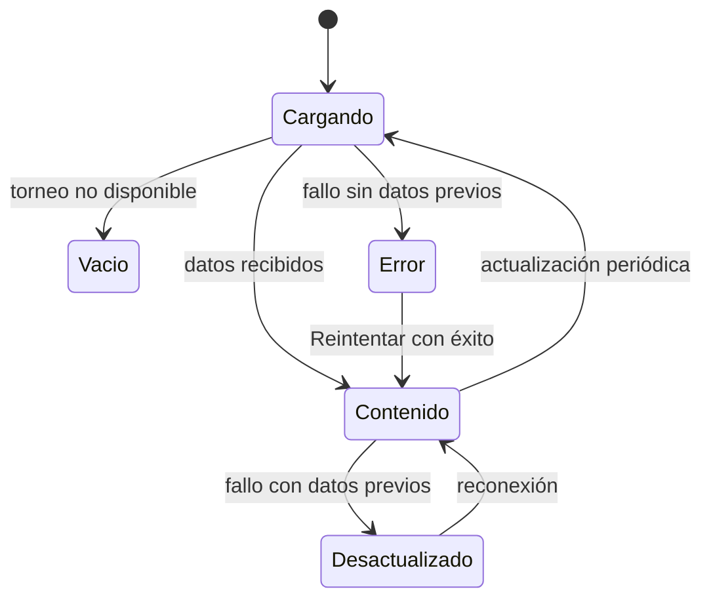

# Manual de la consulta Android

Guía del alumno y espectador para consultar el cuadro del torneo desde Android.
Corresponde a la versión de FC27-06 ([PR #16](https://github.com/cris4899/TorneoFifaJyC/pull/16)),
que conecta la pantalla al servicio de lectura. Las capturas se toman con datos
ficticios sobre esa versión; la sección final indica cuáles y cómo.

## Qué hace la pantalla

La pantalla de cuadro muestra, en modo solo lectura, el torneo en curso o
finalizado: sus rondas, los cruces con marcador y ganador, y el campeón al
terminar. Se actualiza sola mientras está abierta y avisa si pierde la conexión.

## Cómo se usa

1. Abre la aplicación en el móvil. La pantalla de cuadro consulta al abrirse.
2. Usa el selector de ronda para cambiar entre `Semifinales`, `Final`, etc. Cada
   ronda muestra sus cruces como tarjetas en orden.
3. En un cruce jugado se ven el marcador y el ganador. En uno pendiente, los dos
   jugadores o «Por determinar» si falta uno.
4. Al finalizar el torneo, el campeón aparece destacado sobre el cuadro.
5. Si aparece el aviso de sin conexión, pulsa **Reintentar** para volver a cargar.

## Estados de la pantalla

- **Cargando:** consulta en curso; indicador de progreso.
- **Contenido:** cuadro visible y actualizándose cada pocos segundos.
- **Vacío:** no hay cuadro disponible (sin torneos iniciados).
- **Error:** falló la consulta y no hay datos previos; botón **Reintentar**.
- **Desactualizado:** falló la consulta pero se conserva la última versión; se
  avisa y se ofrece **Reintentar**.

## Accesibilidad

- Cada cruce expone una descripción leíble por TalkBack con jugadores, marcador y
  resultado. El estado y el ganador van en texto, no solo en color.
- El nombre del torneo y el campeón son encabezados. El botón **Reintentar**
  tiene pista de accesibilidad.
- Comprobar con un nombre de jugador largo que el texto no se recorta y que
  TalkBack lo lee completo.

## Plan de capturas (datos ficticios)

Capturas a tomar durante la ejecución en Android con los datos ficticios de
`cuadro-ejemplo.json` (una «Copa DAM» de cuatro jugadores). Guardar los archivos
en `docs/capturas/` con el nombre indicado y sin correos a la vista.

| Archivo | Pantalla | Preparación |
| --- | --- | --- |
| `and-01-cuadro-semifinales.png` | Cuadro, ronda Semifinales | Al abrir, con una semifinal jugada (2–1) y otra pendiente. |
| `and-02-cuadro-final.png` | Cuadro, ronda Final | Seleccionar «Final» con una plaza «Por determinar». |
| `and-03-campeon.png` | Cuadro finalizado | Con el campeón destacado. |
| `and-04-vacio.png` | Estado vacío | Sin torneos disponibles. |
| `and-05-error-conexion.png` | Estado error/desactualizado | Cortar la red y pulsar Reintentar; mostrar el aviso. |
| `and-06-talkback-nombre-largo.png` | Accesibilidad | Con TalkBack activo y un nombre de jugador largo. |

> Las capturas requieren la app corriendo en un emulador o dispositivo Android
> (Windows con el workload de Android), que no está disponible en el entorno de
> esta sesión. Esta tarea deja el manual, el diagrama y el guion de capturas; las
> imágenes se añaden en la ejecución sobre la versión de FC27-06.
