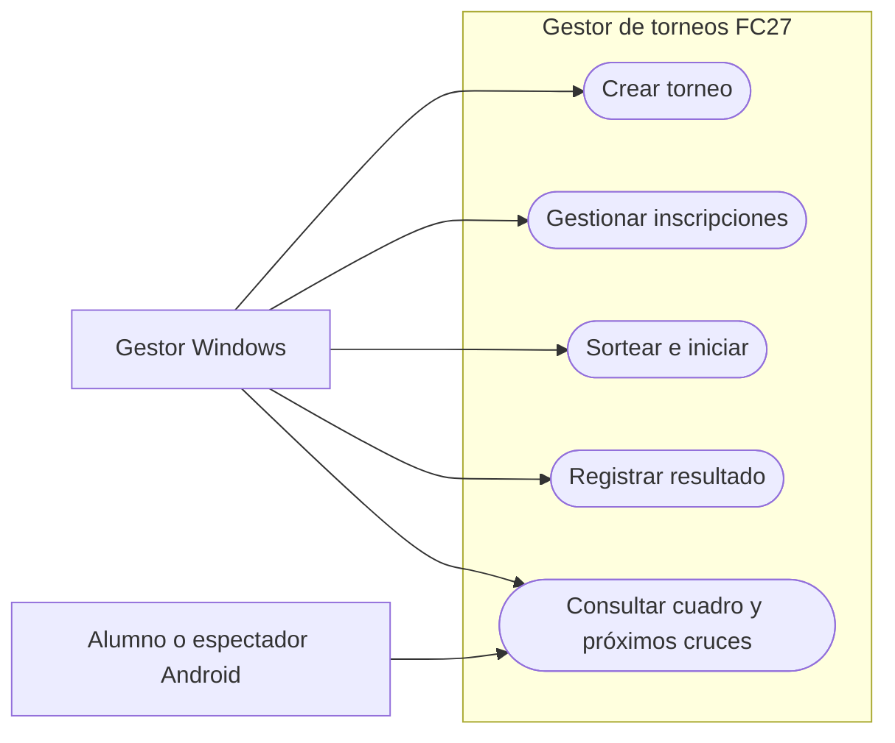

# Especificación de requisitos

El centro organiza torneos de FC27 por eliminación directa. El gestor registra jugadores y resultados desde Windows. Los alumnos y espectadores consultan desde Android quién sigue en competición, qué cruces están disponibles y quién ganó.

## Alcance

- Windows: crear torneos, gestionar inscripciones, sortear, registrar resultados y consultar el cuadro.
- Android: consultar torneos iniciados, cuadro, cruces pendientes y campeón.
- Eliminación directa a partido único con 4, 8, 16, 32 o 64 plazas. La evolución en el cuadro representa la clasificación. Ligas, grupos, tercer puesto y calendario con fechas quedan para iteraciones futuras.

## Casos de uso

| ID | Requisito y criterio de aceptación |
| --- | --- |
| RF-01 | El gestor crea un torneo en Borrador con nombre único y capacidad de 4, 8, 16, 32 o 64. Los demás valores se rechazan. |
| RF-02 | En Borrador se pueden dar de alta, editar y retirar inscripciones. Cada alta exige nombre, correo y equipo. Los correos duplicados y las altas que superen el cupo se rechazan. |
| RF-03 | Con el cupo exacto, el sorteo coloca a cada inscrito una vez en primera ronda, crea todos los cruces y pasa a EnCurso. Con cupo incompleto o sorteo ya realizado, se conserva el estado. |
| RF-04 | Con dos jugadores asignados a un partido pendiente, el gestor registra goles enteros no negativos. Si el marcador empata, se exige un ganador por penaltis. El ganador ocupa su plaza en la fase siguiente. |
| RF-05 | Al registrar el resultado de la final, el torneo pasa a Finalizado y el cuadro muestra al campeón. |
| RF-06 | Android consulta cuadro por rondas, resultados y próximos cruces. Se considera próximo un partido pendiente con ambos jugadores asignados. |
| RF-07 | Android distingue carga, lista vacía, datos actualizados y pérdida de conexión. Si conserva un cuadro en la sesión, lo muestra con la hora de la última consulta correcta. |
| RNF-01 | Ninguna vista ni respuesta de consulta Android contiene correos. Las operaciones administrativas se ejecutan desde Windows. |
| RNF-02 | El cierre del partido y el avance se guardan juntos. Una interrupción durante la operación conserva la versión previa completa. Un reintento idéntico no altera el cuadro. |
| RNF-03 | Objetivo propuesto para la demo: Android refleja un resultado confirmado en un máximo de 10 segundos con el cuadro abierto y ambos dispositivos conectados a la red de prueba. |

## Flujos principales

1. **Preparar torneo.** El gestor guarda nombre y capacidad, registra jugadores y revisa el contador de plazas. La lista queda cerrada al iniciar.
2. **Jugar eliminatorias.** El gestor abre un cruce disponible, revisa los nombres y confirma el marcador. La aplicación coloca al ganador en su plaza siguiente o declara al campeón.
3. **Seguir el torneo.** El alumno abre un torneo iniciado, elige una ronda o consulta los cruces disponibles. Si se pierde la conexión, puede reintentar la consulta.
