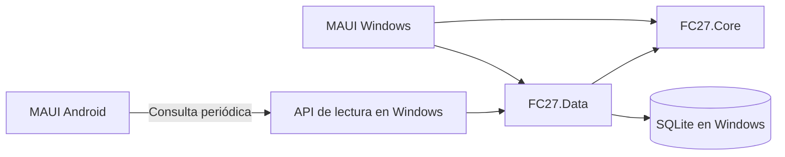
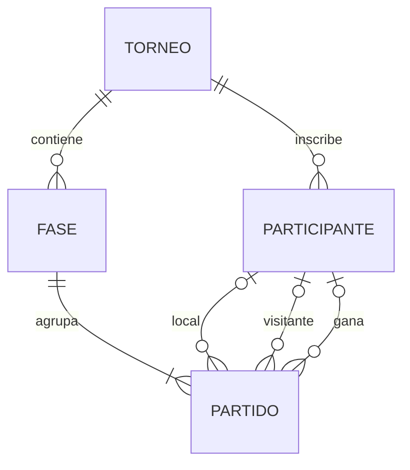

# SDD · Diseño de software del Gestor de torneos FC27

**Estado:** propuesta para revisar antes de implementar. [Requisitos y criterios](requisitos.md).

## Arquitectura

| Componente | Responsabilidad |
| --- | --- |
| FC27.Core | Entidades, contratos de persistencia y casos de uso. Valida inscripciones, construye el cuadro y determina el avance. Sin dependencia de MAUI, HTTP o EF Core. |
| FC27.Data | EF Core, SQLite, migraciones y repositorios. Implementa las transacciones de los casos de uso y las proyecciones de consulta. |
| UI MAUI existente | Vistas Windows y Android en la solución actual. Windows invoca casos de uso locales mediante inyección de dependencias. Android usa el contrato de lectura y comparte sus tipos con Windows. |
| FC27.Api (propuesto) | Proceso ASP.NET Core en el mismo Windows, con acceso de lectura al mismo archivo SQLite. Publica proyecciones para Android. |

La propuesta LAN mantiene el almacenamiento y la edición en el equipo del gestor. El archivo vive en el disco local y la API abre una conexión de solo lectura. Si la API cae, Windows puede seguir gestionando el torneo. La red debe permitir que el móvil alcance al equipo del gestor. Si el centro aísla los dispositivos, se necesita una red autorizada para la demo o un servicio accesible por ambos dispositivos. La exportación manual de instantáneas serviría para una demo sin red con un cambio explícito del requisito de actualización.

## Modelo E/R

### Modelo relacional y restricciones

Las cuatro tablas usan una PK entera autoincremental. Los campos son obligatorios salvo los marcados como opcionales.

| Relación | Atributos y claves |
| --- | --- |
| Torneo | Id, Nombre (único), NumeroParticipantes (4, 8, 16, 32 o 64), Estado (Borrador, EnCurso, Finalizado). |
| Participante | Id, NombreJugador, Email (único global), EquipoFC27, TorneoId → Torneo. El correo se guarda normalizado según política propuesta de recorte de espacios y minúsculas invariantes. |
| Fase | Id, TorneoId → Torneo, Orden (base 1). Clave candidata (TorneoId, Orden). El nombre visible se obtiene del número de partidos de la fase. |
| Partido | Id, FaseId → Fase, Posicion (base 1), EquipoLocalId y EquipoVisitanteId → Participante (opcionales), GolesLocal y GolesVisitante (por defecto 0, no negativos), EstadoPartido (Pendiente, Jugado), GanadorId → Participante (opcional). Clave candidata (FaseId, Posicion). Los IDs de equipo apuntan a las inscripciones del jugador. |

**Grafo relacional:** Participante → Torneo · Fase → Torneo · Partido → Fase · Partido → Participante (local, visitante, ganador).

**3FN.** El torneo de cada partido se obtiene a través de su fase. El nombre de fase, el cruce de destino y el campeón se calculan a partir de las relaciones existentes. GanadorId recoge la resolución del resultado, incluida la tanda cuando los goles empatan. Con un marcador desigual debe coincidir con quien marcó más goles.

SQLite valida claves foráneas activas, unicidad, estados y valores de fila. En Partido, las plazas asignadas deben ser distintas y un ganador debe ser una de ellas. Un partido Jugado exige las dos plazas y ganador. Un Pendiente tiene goles a cero y ganador vacío. El caso de uso valida en la misma transacción que los inscritos pertenecen al torneo de la fase, que se respeta la capacidad y que la plaza de avance es correcta.

## Construcción y avance del cuadro

1. Validar que la capacidad sea una de las cinco permitidas y coincida con el número de inscritos distintos.
2. Barajar los inscritos y emparejar consecutivamente. Para N inscritos, crear log₂(N) fases y N−1 partidos. Las rondas posteriores empiezan con ambas plazas vacías.
3. Para cada fase, usar el número de partidos como etiqueta: 32 → Treintaidosavos, 16 → Dieciseisavos, 8 → Octavos, 4 → Cuartos, 2 → Semifinales, 1 → Final.
4. En la fase siguiente, el ganador del partido en posición p ocupa el partido en posición techo(p/2). Las posiciones impares alimentan la plaza local y las pares la visitante.
5. Guardar marcador, ganador y avance en una transacción. En la final, guardar resultado y estado Finalizado juntos. Un reintento idéntico devuelve el resultado guardado. Un marcador distinto para un partido ya jugado se rechaza y se muestra al gestor. Se propone confirmar el marcador antes de grabarlo y dejar las correcciones para una iteración con reglas de propagación.

El alta del cuadro también es transaccional. La escritura debe verificar el estado previo bajo la misma transacción y un intento concurrente que perdió la carrera debe releer y aplicar la regla de reintento o conflicto. Las consultas del cuadro leen una instantánea consistente.

## Contrato de lectura propuesto

| Operación | Respuesta |
| --- | --- |
| GET /api/v1/torneos | Lista de torneos EnCurso y Finalizado con ID, nombre, capacidad y estado. Lista vacía válida. |
| GET /api/v1/torneos/{id}/cuadro | Datos del torneo, rondas ordenadas y partidos en orden. Cada plaza contiene nombre y equipo, o vacío. Incluye estado, marcador, ganador y campeón si existe. Devuelve 404 para torneo inexistente o Borrador. |

La pantalla de cuadro consulta al abrir, al volver al primer plano y cada 5 segundos mientras está visible. Mantiene una sola consulta en curso, cancela al salir y ofrece reintento manual. El intervalo y el objetivo de 10 segundos se validarán en la demo. La última consulta correcta queda en memoria durante la sesión. Android registra la hora local en que recibe y valida la respuesta. Esa hora alimenta «Actualizado a las» y se conserva durante una desconexión. El contrato no necesita un campo de hora. Android recibe una proyección con los datos mínimos de cada jugador. Se propone usar datos ficticios durante la demo. Antes de usar nombres reales, el centro debe definir quién puede consultar el cuadro y en qué red.

## Decisiones para revisar

1. **Red:** la propuesta LAN sigue pendiente. Validar conectividad y acordar la configuración de acceso en FC27-06, antes de conectar Android al servicio real.
2. **Correo:** para la primera entrega se conserva la unicidad global del encargo. El mismo correo queda reservado por su inscripción incluso en otro torneo.
3. **Empates y correcciones:** la primera entrega guarda el marcador y el ganador por penaltis, sin tanteo de la tanda. El gestor confirma el marcador antes de guardarlo. La corrección de resultados confirmados se reserva para una iteración que defina cómo revertir el avance.
